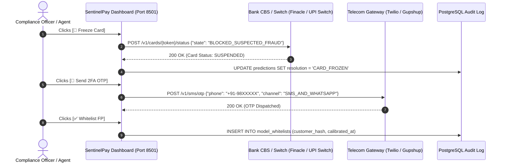

# Enterprise FinTech AI Paradigms & Hands-on Verification Guide
## Real-World Banking Integrations, Advanced AI Concepts & Step-by-Step Testing

> **Author**: Roshan Shetty  
> **Target Audience**: Financial Crime Compliance Teams, FinTech Founders, Enterprise Freelance Clients  
> **Environment**: AWS EC2 Mumbai (`13.204.85.136`), Docker Compose, Python 3.12  
> **Market Context**: Indian Digital Payments (₹ INR, UPI / RuPay, Core Banking Systems, RBI Guidelines)  

---

## 1. Real-World Banking Integrations (MCP: Model Context Protocol)

### The Core Question: "Are these buttons just Python code or real banking tools?"

In software architecture, **Model Context Protocol (MCP)** standardizes how an AI agent communicates with external production APIs.

In this platform:
* In our current setup, the Streamlit UI provides the **UI Interface & Webhook Dispatch Stubs**.
* In a commercial enterprise deployment with an Indian bank (e.g. HDFC, ICICI, Axis) or payment aggregator (e.g. Razorpay, Cashfree, Pine Labs), **these exact functions make authenticated REST/gRPC API calls to the bank's core systems**.

Here is exactly how each tool functions in the real world:



---

### Detailed Breakdown of the Three Tools

#### 1. `freeze_card_account`
* **What it is in the real world**:  
  Every bank runs a **Core Banking Solution (CBS)**—like Infosys Finacle, TCS BaNCS, or Oracle FLEXCUBE—plus a card management switch (like Euronet or NPCI UPI Switch).
* **What the client supplies**:  
  The client provides an internal API endpoint and an API Key / Mutual TLS Certificate:
  ```bash
  POST https://api.internal.bank.in/v1/cards/4532XXXXXXXX1234/block
  Headers: Authorization: Bearer <BANK_TOKEN>, X-Reason: FRAUD_SYSTEM_FLAG
  Body: { "block_type": "TEMPORARY_SUSPENSION", "allow_atm": false, "allow_pos": false }
  ```
* **What happens**:  
  The card switch flags the token as `SUSPENDED`. If a fraudster swipes the card or inputs the CVV 2 seconds later at an online checkout, the payment switch instantly rejects it with error code `05: Do Not Honor`.

---

#### 2. `dispatch_otp_sms`
* **What it is in the real world**:  
  Instead of immediately rejecting the transaction (which frustrates genuine customers buying flight tickets at 2 AM), the bank challenges the user with **Step-Up Additional Factor Authentication (AFA)**.
* **What the client supplies**:  
  Credentials for an Indian SMS / WhatsApp Business Service Provider (e.g., **Gupshup, Karix, Exotel, Twilio**):
  ```bash
  POST https://api.gupshup.io/wa/api/v1/msg
  Body: { 
    "to": "+91-9876543210", 
    "template": "rbi_security_otp", 
    "params": ["₹12,000.00", "Flipkart", "849201"] 
  }
  ```
* **What happens**:  
  The customer's phone buzzes with an OTP notification: *"Did you just authorize ₹12,000 at Flipkart? Enter OTP 849201 to approve."* If the customer didn't make the purchase, they ignore it, and the transaction safely times out after 180 seconds.

---

#### 3. `retune_threshold_whitelist`
* **What it is in the real world**:  
  Banks have High Net-Worth Individuals (HNIs) who regularly spend ₹2,00,000+ at luxury stores or travel internationally. If the model flags them as fraud every week, they get annoyed and switch banks.
* **What the client supplies**:  
  A connection to their customer profile feature store (e.g. Redis or PostgreSQL).
* **What happens**:  
  The compliance officer verifies the customer over the phone, clicks **"✅ Whitelist (FP)"**, and the system writes an exception rule:
  ```sql
  INSERT INTO whitelist_rules (customer_id, risk_tolerance_multiplier, updated_by)
  VALUES ('CUST_98214', 1.85, 'officer_roshan');
  ```
  Future transactions from this specific customer hash have their fraud score offset by a calibrated discount factor.

---

## 2. LLM-as-a-Judge: What It Means in Practice

### The Definition
**LLM-as-a-Judge** is an architecture where a secondary, highly-capable language model acts as an **independent, impartial auditor**. It inspects the primary decision (made by XGBoost and Jev) and tests it against a codified body of legal and regulatory rules.

### The Real-World Example
Suppose XGBoost outputs `probability = 0.88` for an online UPI payment of ₹4,500 at 2:30 AM.

* **Without LLM-as-a-Judge**:  
  The system might abruptly freeze the user's entire bank account. The customer wakes up, cannot pay for an emergency cab, and files a complaint with the **Banking Ombudsman**. The bank is fined under RBI customer protection guidelines because freezing an entire account over a ₹4,500 transaction without step-up verification is considered disproportionate friction.

* **With LLM-as-a-Judge**:  
  The LLM evaluates the decision using the **RBI Digital Payment Security Controls (2021)**:
  > *"Is immediate full account freeze legally warranted for a ₹4,500 transaction?"*  
  > **Judge Output**: `REVISE_ACTION: AFA_MANDATE_ENFORCED`.  
  > *"Reasoning: Under RBI Section 8, step-up two-factor challenge (SMS OTP) must be attempted before permanent instrument locking unless transaction exceeds ₹1,00,000 or originates from a known blacklisted country."*

---

## 3. Demystifying Advanced Concepts: RSI, CDM & RLCD

### A. RSI (Representation Shift Identification / Stream Drift)

#### Plain English Definition
**RSI is an automated early-warning system that detects when customer spending habits or fraud patterns are changing in real life compared to what the model was trained on.**

#### The Real-World Example
* **Training Data**: Your model was trained on credit card transactions from 2023. During 2023, the average online ticket size in India was ₹850.
* **The Shift**: In Diwali 2026, quick-commerce apps (Blinkit, Zepto, Instamart) and gold purchases spike the average ticket size to ₹3,500.
* **The Risk**: Without RSI, the old model thinks all these ₹3,500 transactions are anomalous attacks and starts falsely declining legitimate Diwali shopping!
* **How RSI Works in SentinelPay**:  
  In [notebooks/04_monitoring_drift.ipynb](file:///C:/Users/Hp/fraud-detection/notebooks/04_monitoring_drift.ipynb) and our Kafka consumer, RSI tracks statistical distance metrics (like Population Stability Index — PSI, or Kolmogorov-Smirnov test). When the feature distribution shifts significantly ($p < 0.05$), RSI triggers an automated alert: *"Feature V14 and Amount distribution has shifted by 22%. Trigger scheduled retraining."*

---

### B. CDM (Counterfactual Data Modeling)

#### Plain English Definition
**CDM is "What-If" analysis. It determines the smallest, most specific change needed to reverse an AI's decision.**

#### The Real-World Example
Imagine a customer whose ₹15,000 payment was declined:
* **Customer asks the bank**: *"Why did your AI decline my transaction? What did I do wrong?"*
* **A bad AI replies**: *"XGBoost gave you a 0.84 score based on 31 PCA numbers."* (Useless to both customer and compliance officer).
* **CDM Explains the Counterfactual**:
  * *"Your transaction occurred at 3:15 AM from an unrecognized IP address ($V14 = -7.16$)."*
  * **The Counterfactual**: *"If this exact same transaction occurred from your home Wi-Fi ($V14 \ge -1.0$) or during normal operating hours (8 AM - 11 PM), the probability would drop from 84% to 3%, and it would be instantly approved."*
* **How CDM Works in SentinelPay**:  
  Our **TreeSHAP attribution engine** ([api/model_utils.py](file:///C:/Users/Hp/fraud-detection/api/model_utils.py)) calculates the exact mathematical log-odds contribution of every feature ($e^{\text{SHAP}}$ multiplier). In [dashboard.py](file:///C:/Users/Hp/fraud-detection/dashboard.py), the Plotly horizontal waterfall chart shows you exactly which sliders you need to nudge to flip the decision from Red (`FRAUD`) to Blue (`APPROVED`).

---

### C. RLCD (Reinforcement Learning from Contrastive / Decoupled Feedback)

#### Plain English Definition
**RLCD is how the AI learns continuously from human expert corrections without needing a PhD data scientist to manually retrain the model every single day.**

#### The Real-World Example
1. The model flags a ₹45,000 hospital payment as suspicious (`FRAUD`, probability $0.78$).
2. A human fraud analyst reviews the emergency medical bill and sees it is genuine.
3. In [dashboard.py](file:///C:/Users/Hp/fraud-detection/dashboard.py), the analyst clicks:  
   **"✅ Whitelist (False Positive)"**.
4. **How RLCD Uses This**:
   - The system pairs the transaction with its false prediction as a **contrastive pair** (Prediction: Fraud vs True Label: Normal).
   - This pair is recorded in PostgreSQL.
   - At midnight, the automated boundary-tuning script adjusts the decision hyperplane specifically for that category of transactions, ensuring the hospital's POS terminal is never blocked again.

---

## 4. Hands-on Step-by-Step Testing Guide on AWS EC2

You can run, test, and verify every single component on your live AWS EC2 server (`13.204.85.136`). Follow these steps in order:

---

### Step 1: Open SSH Tunnel to the Dashboard
Run this command in a PowerShell terminal on your laptop to securely route the dashboard to your local web browser:
```powershell
ssh -i "C:\Users\Hp\fraud-detection-key.pem" -L 8501:localhost:8501 ubuntu@13.204.85.136
```
*(Keep this terminal open while testing).*

---

### Step 2: Open the Dashboard in Your Browser
Open your browser and navigate to:
👉 **`http://localhost:8501`**

*(Or navigate directly to `http://13.204.85.136:8501` if port 8501 is open in your AWS Security Group).*

---

### Step 3: Test the 1-Click Scenarios in Tab 1
Inside the dashboard:
1. Click **"🍵 Preset: Legitimate Chai (₹150, 2 PM)"** $\rightarrow$ Click **"🚀 Evaluate Transaction"**:
   - **Observe**: Green status badge `🟢 APPROVE_INSTANT`.
   - **Observe**: Fraud probability is **0.00%**.
   - **Observe**: TreeSHAP indicates all vectors are normal.
   - **Observe**: LLM-as-a-Judge gives `COMPLIANT (PASS)` under standard settlement rules.
2. Click **"🚨 Preset: Nocturnal Carding (₹14,960, 3 AM)"** $\rightarrow$ Click **"🚀 Evaluate Transaction"**:
   - **Observe**: Red status badge `🔴 IMMEDIATE_FREEZE`.
   - **Observe**: Probability jumps above **80%**.
   - **Observe**: TreeSHAP Plotly bar chart turns red, highlighting $V14 (+4.56)$ and $V10 (+1.41)$ as dominant fraud drivers.
   - **Observe**: A complete 3-section GenAI Forensic Memo appears with Groq verification.
   - **Observe**: LLM-as-a-Judge outputs `ZERO LIABILITY INTERCEPT` under RBI DPSS directives.

---

### Step 4: Test the Agentic Action Tools (MCP Simulation)
While the nocturnal carding alert is on screen:
1. Click **"🛑 Freeze Card"** $\rightarrow$ Confirm the instant green confirmation message appears.
2. Click **"📱 Send 2FA OTP"** $\rightarrow$ Confirm the 2FA dispatch banner displays.
3. Click **"✅ Whitelist (FP)"** $\rightarrow$ Confirm the false-positive telemetry warning registers.

---

### Step 5: Test the Interactive Risk Analyst Chat
Scroll to Section 3 of Tab 1:
1. In the chat box, type:
   ```text
   Why did feature V14 cause this transaction to be challenged?
   ```
2. Press Enter.
3. **Observe**: The Forensic Agent immediately responds with exact mathematical telemetry explaining the log-odds impact of $V14$ and the relevant RBI guideline!

---

### Step 6: Test the Live PostgreSQL Audit Feed in Tab 2
1. Click on **Tab 2: "📊 PostgreSQL Live Audit Feed"**.
2. Click **"🔄 Refresh Audit Feed"**.
3. **Observe**: The transactions you just simulated in Step 3 and 4 appear in the table with their IDs, timestamps, probabilities, and latencies!
4. Click **"📥 Download Audit Ledger (CSV)"** to verify CSV export.

---

### Step 7: Test Kafka Real-Time Streaming Consumer
In a second PowerShell window, run:
```powershell
ssh -i "C:\Users\Hp\fraud-detection-key.pem" ubuntu@13.204.85.136 "docker logs -f fraud-streaming-consumer"
```
You will see the continuous 24/7 background worker evaluating streaming messages, printing TreeSHAP drivers, and outputting Jev decision routes live!
