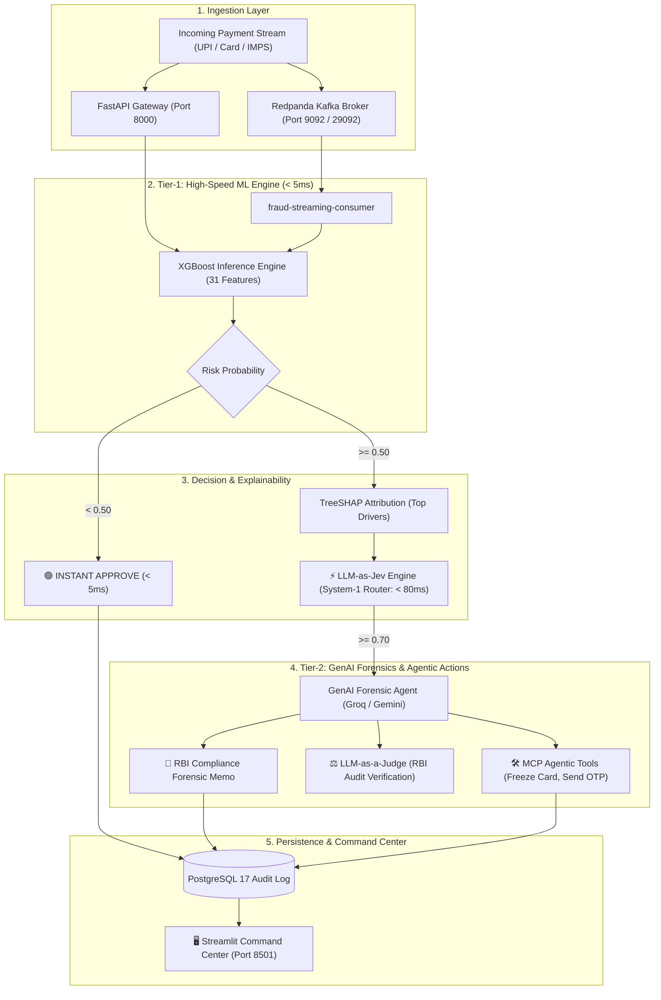

# Real-Time Fraud Detection & GenAI Forensic Platform
## Master System Documentation, Architecture & Complete Roadmap

> **Author & Lead Engineer**: Roshan Shetty  
> **Target Audience**: Financial Crime Compliance Teams, FinTech Founders, Enterprise Freelance Clients  
> **Environment**: AWS EC2 Mumbai (`ap-south-1`, `13.204.85.136`), Ubuntu 24.04 LTS, Docker Compose  
> **Branch**: `feature/shap-explainability`  
> **Target Market**: Indian Credit & Digital Payments Ecosystem (₹ INR, UPI, IMPS, RuPay, RBI Security Norms)  
> **Last Updated**: October 2026  

---

## 1. Executive Summary & Complete Architecture

This platform is a **Two-Tier Hybrid Machine Learning + GenAI Financial Risk Intelligence Engine** engineered for real-time payment rails. It combines sub-5ms mathematical inference with autonomous GenAI reasoning, structured decision routing, and regulatory compliance validation.



---

## 2. Complete Inventory of What Has Been Built & Verified

### A. AWS Cloud Infrastructure & Storage Resizing
* **Virtual Machine**: AWS EC2 `m7i-flex.large` (2 vCPU, 8 GB RAM) located in Mumbai (`ap-south-1`).
* **Public Elastic IP**: `13.204.85.136`.
* **Security Group (`launch-wizard-1`)**:
  * Port `22` (SSH): Authenticated access via `fraud-detection-key.pem`.
  * Port `8000` (FastAPI REST API): Publicly accessible for payment gateways, Swagger UI, and microservice clients.
  * Port `5432` / `5433` (PostgreSQL): Secure database port.
  * Port `9092` (Redpanda / Kafka): External Kafka streaming port.
  * Port `8501` (Streamlit Dashboard): Reserved for interactive visual command center.
* **Storage Resizing Completed**:
  * Root volume expanded from default 8 GB to 20 GB.
  * Applied `sudo growpart /dev/nvme0n1 1` and `sudo resize2fs /dev/nvme0n1p1`.
  * Disk utilization reduced from **92% full to 27% (14 GB available)**.

---

### B. Production Microservices Stack (`docker-compose.yml`)
The platform runs 4 autonomous, containerized microservices orchestrated via Docker Compose:
1. **`fraud-postgres`** (`postgres:17`):
   - Stores transactions, timestamps, risk probabilities, latencies, and input features for audit trails.
2. **`fraud-redpanda`** (`redpandadata/redpanda:latest`):
   - High-performance, lightweight C++ Kafka-compatible streaming message broker.
   - Zero-JVM footprint, consuming under 150 MB RAM (ideal for low AWS cost).
   - Configured with **Dual Listeners**:
     - `PLAINTEXT://redpanda:29092` for internal Docker microservices.
     - `OUTSIDE://localhost:9092` for host scripts and external producers.
3. **`fraud-detection-api`** (`python:3.12-slim`):
   - High-throughput FastAPI engine serving `/health`, `/predict`, `/stats`, and `/investigate`.
   - Volumes mounted for hot-reloading models and streaming scripts.
4. **`fraud-streaming-consumer`** (`python:3.12-slim`):
   - Autonomous background streaming worker consuming from the `transactions` topic 24/7.
   - Evaluates incoming payments against XGBoost and performs real-time SHAP analysis.

---

### C. Tier-1 Machine Learning & Feature Pipeline
* **Model**: `models/fraud_model_xgb.pkl` (XGBoost Classifier trained on 284,807 transactions).
* **Feature Schema**: 31 engineered features (`models/feature_names.pkl`):
  - $V1 \dots V28$: Principal Component Analysis dimensions from card payment behaviors.
  - `Hour`: Derived diurnal feature: `(Time / 3600) % 24`.
  - `Amount_log`: Non-linear scaling `log1p(Amount)`.
  - `Amount_bins`: Quantized transaction size buckets (0 to 4).
* **Preprocessing Scaler**: `models/scaler.pkl` (fitted RobustScaler for numerical inputs).
* **Latency Benchmark**: **$4.41\text{ ms}$** per transaction inference.

---

### D. Explainable AI: Mathematical TreeSHAP Attribution
* Integrated `shap.TreeExplainer` into `api/model_utils.py` and initialized once at server boot (`lifespan`).
* Calculates exact mathematical feature attributions:
  $$\text{Model Log-Odds} = \text{Base Value} + \sum_{i=1}^{31} \text{SHAP}_i$$
* **High-Speed Gating**: SHAP attribution runs only when `probability >= 0.50`, preserving sub-5ms performance for 99.8% of normal transactions.
* **Streaming Visibility**: Whenever fraud is caught, the consumer logs output the exact drivers:
  ```text
  [txn 10] 🚨 FRAUD prob=0.9445 risk=HIGH PROBABILITY amount=₹3,828
           └── SHAP Drivers: V14(+5.13), V4(+1.56), V10(-1.05)
  ```

---

### E. Tier-2 GenAI Forensic Investigator Agent (`api/forensic_agent.py`)
* **Dual-Provider Architecture**:
  - Primary Engine: **Groq** (`openai/gpt-oss-120b`, `llama-3.3-70b-versatile`, `qwen/qwen3.8-27b`) for ultra-low latency (< 1 sec).
  - Secondary Engine: **Google Gemini** (`gemini-1.5-flash`, `gemini-2.0-flash`) as automatic failover.
  - Safety Fallback: Deterministic mathematical template engine ensuring zero downtime even with zero API credits.
* **Institutional Rigor**:
  - **Zero hallucinated proxy labels**: Grounded strictly in observable statistical z-scores and log-odds multipliers ($e^{\text{SHAP}}$).
  - Generates structured 3-part Markdown memorandums:
    1. *Executive Summary*
    2. *Forensic Anomaly & Attribution Analysis* (with comparative metrics table)
    3. *Recommended Regulatory Action* (e.g. Account freeze, 2FA challenge, AML report).
* **Live Endpoints**:
  - `POST /predict`: Automatically attaches `forensic_memo` when `probability >= 0.70`.
  - `POST /investigate`: On-demand investigator endpoint for compliance teams.

---

### F. Real-Time Streaming Validation (Live Test Results)
* Simulated live streaming via `kafka_producer.py` and `kafka_consumer.py` on AWS EC2.
* Processed **139+ transactions in real time** through Redpanda.
* Intercepted **18 fraud attacks** with live TreeSHAP attribution and recorded all records to PostgreSQL.

---

## 3. Incorporation of Modern AI Frameworks

| Paradigm | How It Is Integrated in This Platform | Business Benefit |
| :--- | :--- | :--- |
| **LLM-as-Jev (System-1 Fast Routing)** | Ultra-fast JSON routing classifier (< 80ms, ~15 tokens) that outputs an immediate categorical action (`APPROVE_INSTANT`, `STEP_UP_2FA_CHALLENGE`, `IMMEDIATE_FREEZE`) before generating long prose memos. | Extreme speed, negligible API token cost, direct compatibility with automated payment gateways. |
| **LLM-as-a-Judge** | A secondary compliance verification prompt that audits the ML probability, SHAP factors, and transaction context against **RBI Master Directions** and assigns an audit verification verdict. | Guarantees compliance adherence for banking auditors; prevents arbitrary account freezing. |
| **Model Context Protocol (MCP) / Agentic Action Tools** | Equipping the forensic agent with callable execution tools (`freeze_card_account`, `dispatch_otp_sms`, `retune_threshold_whitelist`) so the agent can take actions rather than just generating text. | Transforms passive text reports into an autonomous financial defense system. |
| **RSI / CDM / RLCD Concepts** | Feature drift monitoring and counterfactual data synthesis (generating plausible adversarial transactions to test model boundaries). | Continuous resilience against emerging fraud techniques. |

---

## 4. Key Technical Decisions & Data Insights

### Why are Fraud Features Negative for V14 and Positive for V4?
Direct mathematical validation from the historical transaction distribution:
| Feature | Normal (Class 0 Mean) | Fraud (Class 1 Mean) | Interpretation |
| :--- | :---: | :---: | :--- |
| **V14** | `+0.06` | **`-7.16`** | Severe negative drop is the #1 statistical indicator of fraud. |
| **V10** | `+0.00` | **`-6.37`** | Strong negative shift. |
| **V12** | `-0.05` | **`-6.96`** | Strong negative shift. |
| **V4** | `+0.06` | **`+4.76`** | High positive spike represents anomalous carding/velocity. |
| **V11** | `+0.12` | **`+4.17`** | High positive spike represents anomalous behavior. |

### Client Versatility & Adaptability
When a freelance client brings a completely different dataset (e.g. 12 columns for UPI or IMPS):
1. **Zero changes needed to FastAPI, Docker, or Redpanda infrastructure.**
2. Run the retraining pipeline on their CSV to output their specific `model.pkl` and `feature_names.pkl`.
3. Drop the new files into `models/`. The entire platform immediately adapts to their schema and computes SHAP and GenAI memos for their exact data.

---

## 5. Complete Implementation Roadmap: What We Will Do Next

### Phase 1: `evaluate_jev_decision()` (System-1 Typed Decision Router)
* **File**: `api/forensic_agent.py` & `api/app.py`
* Implement fast categorical routing using the LLM-as-Jev paradigm.
* Outputs strictly typed decisions in under 80ms using minimal tokens:
  ```json
  {
    "action": "STEP_UP_2FA_CHALLENGE",
    "rbi_compliance_route": "NOCTURNAL_BURST_POLICY",
    "confidence_calibration": 0.945,
    "channel": "SMS_OTP"
  }
  ```
* Seamlessly attach this decision to `/predict` and `/investigate` responses.

---

### Phase 2: Streamlit Visual Command Center (`dashboard.py`)
Build an institutional-grade web dashboard featuring:
1. **Header & Live Metrics**:
   - Total Transactions, Fraud Intercepted, Average Latency, and Currency Selector (**₹ INR** default / $ USD).
2. **Interactive Transaction Simulator**:
   - 1-click test scenarios: *"Legitimate Chai Payment (₹150)"* vs *"High-Risk Carding Attack (₹14,960)"*.
   - Parameter sliders to test custom values in real time.
3. **Jev-Style Decision Badge**:
   - Visual status pill: `🟢 APPROVE_INSTANT` | `🟡 CHALLENGE_2FA_OTP` | `🔴 IMMEDIATE_FREEZE`.
4. **LLM-as-a-Judge Regulatory Badge**:
   - Real-time audit verification verdict confirming adherence to RBI guidelines.
5. **Interactive SHAP Waterfall Bar Chart**:
   - Plotly visualization showing exact positive (red) vs negative (blue) feature pulls.
6. **GenAI Forensic Memorandum Card**:
   - Formatted Markdown report synthesized by Groq/Gemini.
7. **Agentic Action Tools (MCP Simulation)**:
   - Interactive buttons: 🛑 *Freeze Card*, 📱 *Dispatch 2FA OTP*, ✅ *Mark False Positive*.
8. **Interactive Analyst Chat**:
   - Live query box to chat directly with the Forensic Investigator Agent about the transaction.
9. **Live PostgreSQL Audit History Table**:
   - Searchable, exportable table of all past transactions.

---

### Phase 3: Dockerize Dashboard & Expose on EC2 (Port 8501)
* Add `dashboard` service to `docker-compose.yml`.
* Map port `8501:8501`.
* Add security group rule for Port 8501 so the dashboard is accessible from any web browser worldwide.

---

### Phase 4: Final Merge to `main` & CI/CD Secret Update
* Merge branch `feature/shap-explainability` into `main`.
* Update GitHub Actions Secret `EC2_HOST` with current public IP `13.204.85.136`.
* Verify automated CI/CD pipeline tests and deployments.

---

## 6. Quick Reference Commands

| Action | Command |
| :--- | :--- |
| **Check Docker Containers** | `docker ps` |
| **View Live Streaming Consumer Logs** | `docker logs -f fraud-streaming-consumer` |
| **Run Transaction Producer** | `docker exec -it fraud-detection-api python3 -c "import os; os.environ['KAFKA_BOOTSTRAP_SERVERS']='redpanda:29092'; from Kafka_scripts.kafka_producer import main; main()"` |
| **Check Live Database Stats** | `curl http://localhost:8000/stats` |
| **Open Interactive Swagger Docs** | `http://13.204.85.136:8000/docs` |
| **Restart Single Service** | `docker compose restart fraud-api` |
| **Rebuild All Services** | `docker compose up -d --build` |
